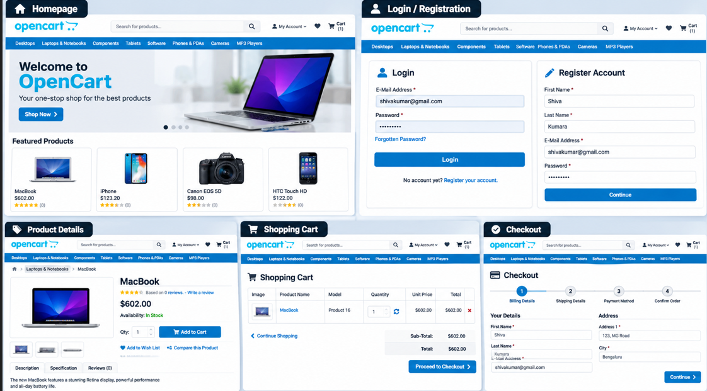

# Shiva Kumara S N — Software Testing & Quality Assurance

Personal portfolio highlighting my background, skills, and hands-on software testing projects.

## View the portfolio

Open [`index.html`](index.html) in a web browser, or publish the repository with GitHub Pages.

## Skills

- Manual and functional testing
- Test scenario and test case design and execution
- Defect reporting and regression testing
- SDLC and STLC
- SQL and database validation
- API testing with Postman

## Testing projects

### OrangeHRM — Web Application Testing

**Tools:** Manual Testing, SDLC, STLC, PostgreSQL, SQL, Excel

- Analysed application workflows and identified test scenarios for Login, Employee (PIM), and Admin modules.
- Designed functional test cases covering positive, negative, and validation scenarios.
- Executed manual test cases and documented actual results and execution evidence.
- Practised SQL queries using a PostgreSQL sample employee database with OrangeHRM employee records.
- Prepared regression test cases and execution summaries to verify previously tested application functionality.

[GitHub profile](https://github.com/Shivu6573) · [Live application](https://opensource-demo.orangehrmlive.com/) · [Browse documentation](OrangeHRM_Web_Application_Testing/index.html)

### OpenCart — E-commerce Web Application Testing

**Tools:** Manual Testing, SDLC, STLC, PostgreSQL, SQL, Excel

- Analysed application workflows and identified test scenarios for Customer Registration, Login, Product Catalogue, Shopping Cart, and Checkout modules.
- Designed and documented test cases and test data covering positive, negative, and validation scenarios.
- Executed manual test cases and recorded actual results against expected results with execution evidence.
- Practised SQL queries using PostgreSQL sample e-commerce data to validate customer records, product details, and order information.
- Prepared regression test cases, documented defects, and maintained test execution summaries to verify application functionality.

[GitHub profile](https://github.com/Shivu6573) · [Live application](https://demo.opencart.com/) · [Browse documentation](OpenCart_E-commerce_Application_Testing/index.html)
